# DSH Git

一个 [DeepSeek Harness](https://github.com/deepseek-ai/deepseek-harness)（DSH）Web/Desktop 插件：
在**右侧栏**提供类 VSCode「源代码管理」面板，直接查看当前分支、工作区变更与提交历史。

**插件类型：** Cordis 插件 bundle（双面：Host 半边 + Web Client 半边），不是皮肤 / TUI / 桌面客户端。

## 能力

- **会话头部常驻分支芯片**：会话标题栏直接显示 `● main 3`（分支 + 变更数 + ahead/behind），点开是工作区变更摘要 —— 不用打开面板就知道当前在哪个分支
- **当前分支状态**：分支名、当前 commit、上游分支、ahead / behind 计数；detached HEAD 与空仓库都能正确显示
- **VSCode 风格配色**：状态字母按语义着色（M 琥珀、A/未跟踪 绿、D 红、R/C 蓝、冲突 橙），文件名跟随状态着色，深浅主题各有一套；`HEAD -> main` / 远端引用各有颜色
- **提交图（GRAPH）**：历史列表左侧绘制彩色泳道（圆点 + 竖线 + 合并/分叉曲线）；普通分支用 8 色调色板，**HEAD 所在分支线用强调色并加大圆点+描边环**，列号跨行稳定、分支线不跳色
- **分支面板（顶部）**：点芯片即开——当前分支段（upstream / ahead / behind / 变更摘要）+ 切换分支（本地分组、当前打勾，点击即 checkout）+ 分支操作（创建 / 重命名 / 删除，删除有二次确认且禁止删当前分支，未合并需强制删除）
- **IDEA 风格变更树**：按目录折叠/展开，每个文件带 `+N/-N` 行数，四分组（已暂存/变更/未跟踪/冲突）不变
- **hunk 级暂存**：diff 内每块可「暂存此块 / 取消暂存此块」，只把该块应用到索引
- **提交增强**：amend 上一个提交 + 最近 10 条提交信息复用（本地保存）
- **历史过滤**：按提交信息 / 作者 / 路径过滤，条件可见且可清除；「日志范围」与「切换到此分支」是两个独立动作
- **stash**：列表 / 创建 / 应用 / 弹出 / 删除（弹层内操作，删除需确认）
- **工作区变更**：按 VSCode 语义分成 **已暂存 / 变更 / 未跟踪 / 冲突** 四组，含状态字母（M/A/D/R/C/U/?）与重命名原路径
- **逐文件 diff**：结构化 unified diff（hunk + 行号 + 增删着色），支持工作区 / 已暂存 / 未跟踪（合成）/ 指定提交四种视角；二进制文件有明确提示
- **写操作**：暂存、取消暂存、放弃变更（二次确认）、填写提交信息并提交（Ctrl/Cmd+Enter）
- **提交历史（IDEA 风格）**：左侧分支树（HEAD / 本地 / 远端，点击只改日志范围不改 HEAD）+ 右侧列式列表（图 / 主题+refs / 作者 / 日期 / 短哈希）；合并提交斜体弱化、HEAD 行强调；支持文本 / 作者 / 路径 / **日期范围**过滤和 ↑/↓/Enter 键盘导航；提交详情（完整 sha、正文、变更文件与增删行数）与逐文件 diff
- **分支**：分支下拉 + 切换分支（`git checkout <branch>`）
- **自动刷新**：面板可见时变更列表每 4s 轮询；所有写操作成功后立即重新拉取
- 中文 / 英文文案，跟随宿主主题（深色 / 浅色）

插件是一个**双面 bundle**：Host 半边（`index.js`）在 DSH 进程内注册 `/git/*` HTTP 路由并调用本机 `git` CLI；
浏览器半边（`client.js`）在右侧栏注册 `git` 标签类型。无构建步骤、无运行时依赖。

## 安装

> 插件类型：**Cordis 插件 bundle**（Host 半边 + 浏览器半边，不是皮肤 / TUI / 桌面客户端）。
> 一句话职责：在 DSH 右侧栏与会话头部提供类 VSCode/IDEA 的 Git 源码管理。

前置：DSH Web/Desktop **0.2.1-rc.5**（依赖右侧栏标签扩展点 `sidebarRightTabs` + `sidebar.right.pane.tab` 槽位）。

### 从 npm 安装（推荐）

```bash
dsh plugin --profile desktop add @wx-98/dsh-git
```

### 从 GitHub 安装

```bash
dsh plugin --profile desktop add github:wx-98/DSH-GIT
```

### 本地目录安装（开发用）

GUI：**Plugins → Add plugin → 本地绝对路径**，填本仓库目录（例如 `D:\code\DSH\Plugin\git`），
安装后在 Plugins 页启用 `@wx-98/dsh-git` 这个 bundle row，刷新页面。

> `desktop` profile 由 Electron 应用独占管理，CLI 会拒绝操作；此时用 GUI 安装，或运行本仓库的一键脚本：

```powershell
pwsh -File .\tools\install-desktop.ps1              # 安装（重启 DSH 后生效）
pwsh -File .\tools\install-desktop.ps1 -LivePatch  # 额外写 live patch，让运行中的实例立刻热加载 Host 半边
pwsh -File .\tools\install-desktop.ps1 -RemoveLivePatch
```

本地目录以 link 方式安装，改动 `client.js` 刷新页面即生效；Host 半边改动需重启应用（或用 `-LivePatch` 热加载）后生效。
## 使用

1. 打开任意会话（Git 面板以**会话 cwd** 为仓库根）；
2. 打开右侧边栏 → 点 **+** → 在标签向导里选 **源代码管理**（标签标题显示为 `Git` + 当前分支）；
3. **变更**标签：填写提交信息 → 暂存/放弃文件 → 提交；
4. **历史**标签：浏览提交、点开看详情与逐文件 diff；
5. 顶部摘要行的刷新按钮可手动刷新，分支下拉可切换分支。


## 界面

| 变更（配色） | 历史（提交图） | diff |
|---|---|---|
| 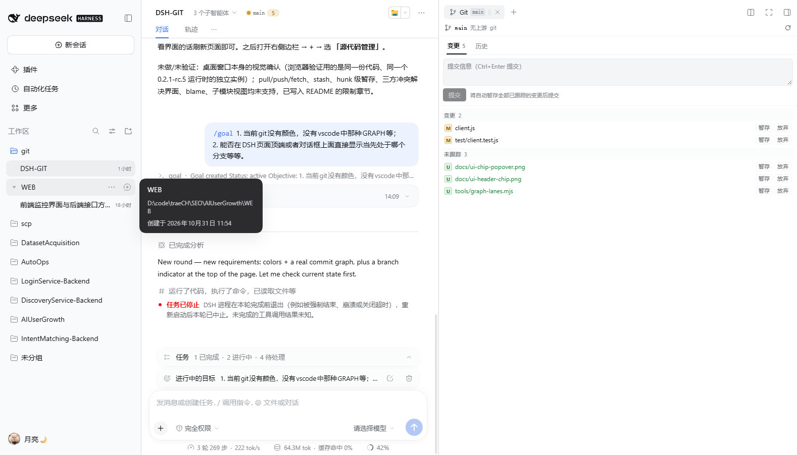 | 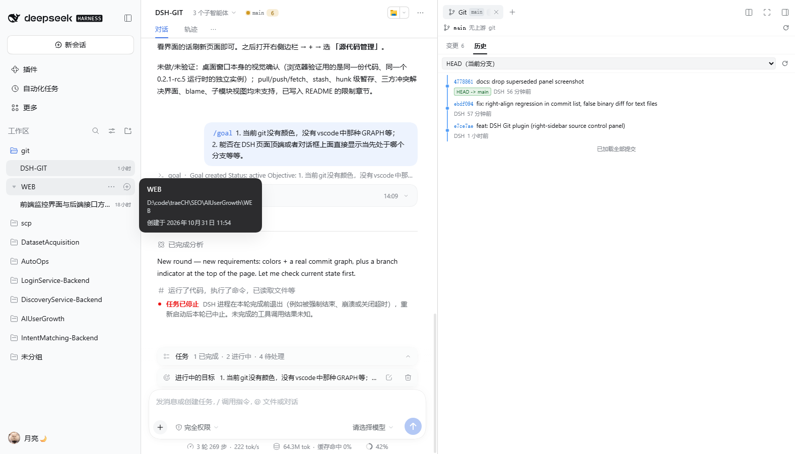 | 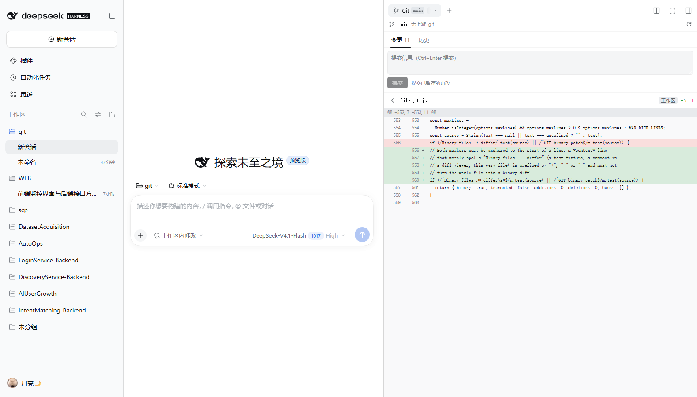 |

| 会话头部分支芯片 | 芯片弹出的变更摘要 | 带分支的提交图 |
|---|---|---|
| 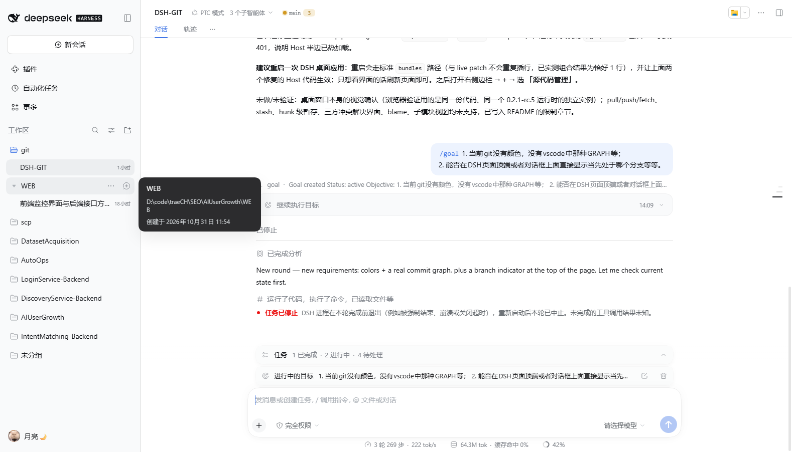 | 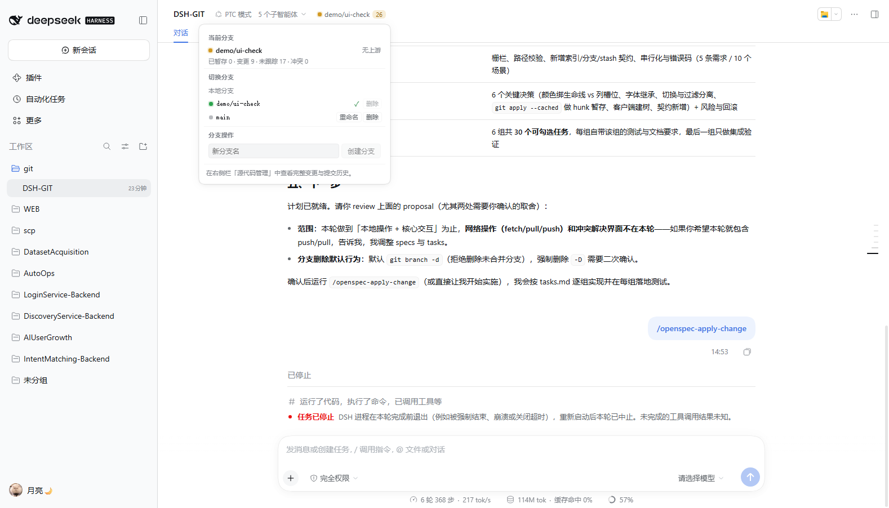 | 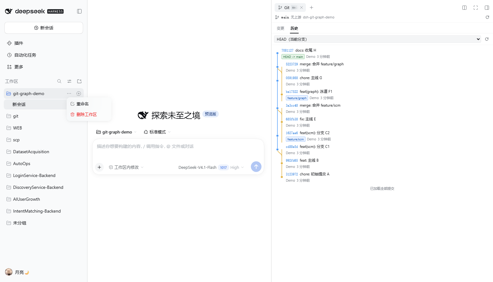 |

| 变更树（目录 + 行数） | hunk 级操作 | IDEA 风格历史 |
|---|---|---|
| 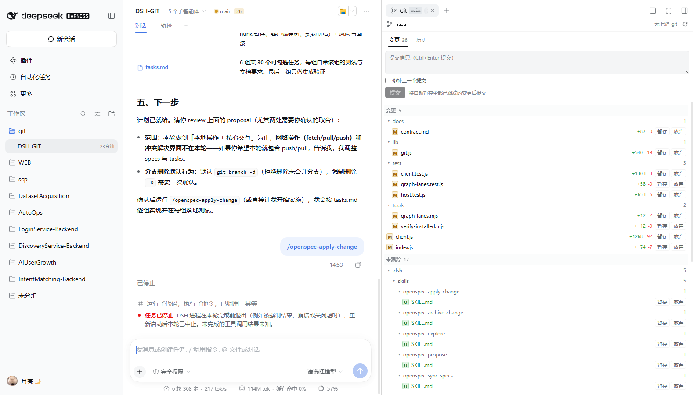 | 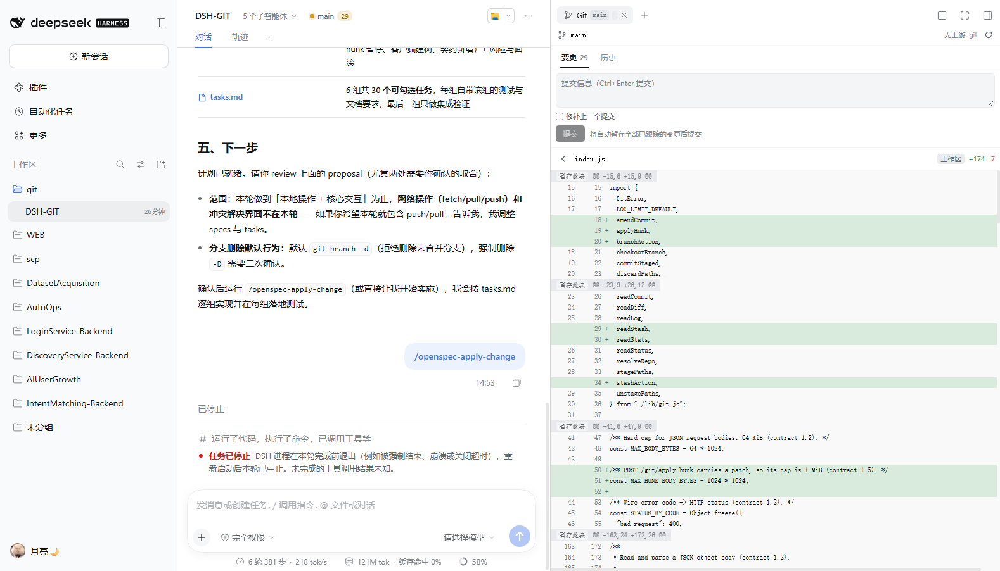 | 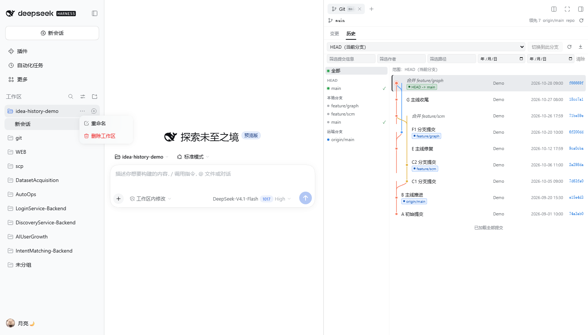 |

| 上游显示（有上游） | 游离 HEAD |
|---|---|
| 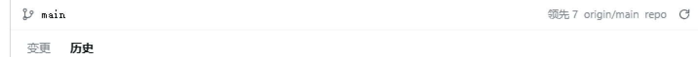 | 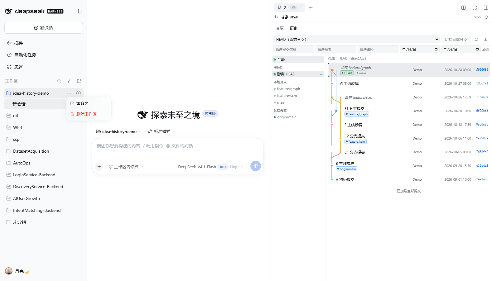 |

|---|---|
|  |  |

## 架构

```
package.json        插件包清单（exports / dsh.bundle.patch / dsh.client）
cordis.patch.yml    Loader 行插入（Host 半边 + 浏览器半边）
index.js            Host 半边：/git/* 路由（连接栅栏、写操作串行队列、错误映射）
lib/git.js          git CLI 封装与解析（status/diff/log/commit/branches/stage/...）
client.js           浏览器半边：右侧栏标签类型、Git 面板、提交图、diff 视图、头部分支芯片
tools/graph-lanes.mjs  提交图泳道算法（纯函数，client.js 内联同一份实现）
locale/             插件管理页展示文案（zh/en）
docs/contract.md    Host ⇄ Client 的接口契约（单一事实来源）
tools/verify-installed.mjs  安装后对真实 DSH 实例的端到端自检
test/               Host / Client 双向测试（node --test）
```

- Host 只通过 `git` CLI 操作仓库，不直接读写 `.git` 内部文件；
- 所有请求先过 DSH 的**连接信任栅栏**（`ctx.connection.requestRejection`：Host/Origin 校验 + 登录 cookie），未认证请求返回 401/403；
- 路径参数必须是**仓库相对路径**，`..` 上跳、绝对路径、NUL 一律拒绝；`discard` 需要显式 `confirm: true`；
- 写操作（stage/unstage/discard/commit/checkout）串行执行，避免并发互相踩；
- 不产生任何模型可见事件。

## 开发

```bash
node --test test/                 # Host + Client 测试
node tools/verify-installed.mjs "http://127.0.0.1:PORT/?token=XXXX"   # 对真实运行中的 DSH 实例做端到端自检
```

自检脚本会：用启动 token 换 cookie → 从 `__DSH_BOOT__` 断言插件已进入客户端入口图 →
拉取被 `/plugins` 服务的浏览器半边 → 造临时仓库并逐条驱动 `/git/*` 路由 → 断言连接栅栏。

## 验收

测试与真实实例端到端验证的记录见 [docs/verification.md](docs/verification.md)：51 项自动化测试全绿，
真实 DSH 0.2.1-rc.5 实例上 18 项端到端断言全过，桌面端运行中的应用里 Host 半边已热加载（`/git/health` 返回 401 栅栏）。

## 兼容性与已知限制

- 目标 DSH 0.2.1-rc.5；依赖其公开扩展点（`sidebarRightTabs`、`slots`、`webServer`、`connection`、`locale`），DSH 升级后建议重新回归。
- 暂不支持：分支创建/删除、pull/push/fetch、stash、hunk 级暂存、三方冲突解决界面、文件历史（blame）、子模块视图；
- 大 diff 会被截断（超过 4000 行）并提示；
- 仅支持本机 `git` CLI（要求 `git` 在 PATH 中或安装在 Windows 默认路径）。

## 许可证

MIT
